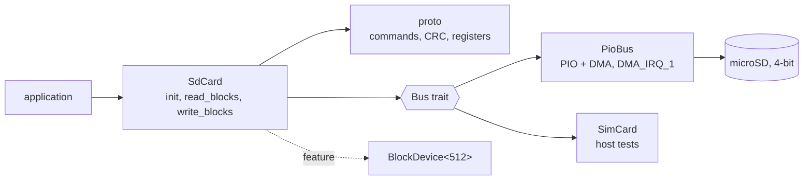

# pio-sdmmc

Native four-bit SD card driver (async, `no_std`) for the MARV V2 Rev 1 flight controller (RP2350B). The protocol and the card driver
(`SdCard`: identification, block reads and writes, error recovery) are hardware-independent and reach the card only through the `Bus`
trait. A PIO + DMA bus for the RP2350 is behind a feature, and a simulated card with fault injection runs the host tests.



## Usage

Against the simulated card (compiled and run as a doctest; needs `embassy-futures` and feature `sim`):

```rust
use embassy_futures::block_on;
use pio_sdmmc::sim::{SimCard, SimConfig};
use pio_sdmmc::{Block, Config, Error, SdCard};

# fn main() -> Result<(), Error> {
let mut card = SdCard::new(SimCard::new(SimConfig::default()), Config::default());
block_on(async {
    card.init().await?;
    let mut out = [Block::new(); 4];
    out[0].as_bytes_mut()[..5].copy_from_slice(b"hello");
    card.write_blocks(100, &out).await?;
    let mut back = [Block::new(); 4];
    card.read_blocks(100, &mut back).await?;
    assert_eq!(&back[0].as_bytes()[..5], b"hello");
    Ok::<(), Error>(())
})?;
let info = card.info().expect("initialised");
assert_eq!(info.capacity_blocks, 124_735_488);
# Ok(())
# }
```

On the board with the PIO bus (does not compile on a host; `hil/src/bin/sd_smoke.rs` is the compiled original):

```text
static SD_WAKER: AtomicWaker = AtomicWaker::new();
struct SdWaker;
impl DmaWaker for SdWaker { fn waker() -> &'static AtomicWaker { &SD_WAKER } }

bind_interrupts!(struct Irqs {
    PIO0_IRQ_0 => pio::InterruptHandler<PIO0>;
    DMA_IRQ_1 => DmaIrqHandler<SdWaker>;
});
let p = embassy_rp::init(Default::default());
let Pio { mut common, sm0, .. } = Pio::new(p.PIO0, Irqs);
let bus = PioBus::new(&mut common, sm0, p.DMA_CH4, Irqs,
    p.PIN_32, p.PIN_33,                      // CLK, CMD
    p.PIN_28, p.PIN_29, p.PIN_30, p.PIN_31,  // DAT0..DAT3
    PioBusConfig::default());
let mut card = SdCard::new(bus, Config::default());
card.init().await?;
```

Build the bus on the core that is to take `DMA_IRQ_1`. Another back-end only has to implement `Bus` (`src/bus.rs` states the rules).

## Docs

| Page | Contents |
|---|---|
| [docs/device.md](docs/device.md) | Socket, pins, pull-ups, GPIOBASE, tested card facts |
| [docs/driver.md](docs/driver.md) | What `SdCard` does, errors, recovery rules, logging options, limits |
| [docs/pio-bus.md](docs/pio-bus.md) | The PIO + DMA bus: clocking, DMA channel and `DMA_IRQ_1`, cancel sequence |
| [docs/testing.md](docs/testing.md) | Host tests, simulated card, on-board programs, features |

## Status

- Version 0.1.0, `publish = false`; the API may still change.
- Host tests: fault, sweep and block-device tests against the simulated card (`cargo test --no-fail-fast`).
- On the board: the on-board programs pass on one board with one SanDisk 64 GB SDXC card at `clk_sys` 150 MHz and a 25 MHz data clock.
  Cancellation recovery on the real card is verified in the data phase only.
- Not verified: other cards (SDSC, SDHC, other makers), High Speed mode (not implemented), cancels inside a command frame or busy wait,
  read CRC errors, rejected writes, card removal and power loss on real hardware (simulated only).

Used by: MARV-FC firmware.

## MARV project

| Repository | Role |
|---|---|
| [MARV-FC](https://github.com/Lmx154/MARV-FC) | Flight-controller firmware for the MARV V2 board (RP2350B) |
| [MARV-GCS](https://github.com/Lmx154/MARV-GCS) | Ground station (`marv-gcs`) and command line (`marv-cli`) |
| [MARV-sim](https://github.com/Lmx154/MARV-sim) | Simulator that runs the firmware's flight code |
| Sensors | [icm45686](https://github.com/Lmx154/icm45686-rs) · [lsm6dsk320x](https://github.com/Lmx154/lsm6dsk320x-rs) · [bmp581](https://github.com/Lmx154/bmp581-rs) · [bmm350](https://github.com/Lmx154/bmm350-rs) · [sam-m10q](https://github.com/Lmx154/sam-m10q) · [adc-battery](https://github.com/Lmx154/adc-battery) |
| Board I/O | **pio-sdmmc** · [qmi-psram](https://github.com/Lmx154/qmi-psram-rs) · [ws2812c](https://github.com/Lmx154/ws2812c-rs) · [usb-cdc](https://github.com/Lmx154/usb-cdc) · [pio-uart](https://github.com/Lmx154/pio-uart) |
| Motors and links | [dshot](https://github.com/Lmx154/dshot-rs) · [esc-passthrough](https://github.com/Lmx154/esc-passthrough) · [rc-port](https://github.com/Lmx154/rc-port) · [crsf-codec](https://github.com/Lmx154/crsf-codec) · [mavlink-device](https://github.com/Lmx154/mavlink-device) · [marv-dialect](https://github.com/Lmx154/marv-dialect) |
| Other drivers | [lc76g](https://github.com/Lmx154/lc76g-rs) (Quectel LC76G GNSS) |

## Licence

MIT, see `LICENSE`. The protocol follows the SD Physical Layer Simplified Specification, cited in the doc comments of `proto` and `card`.
