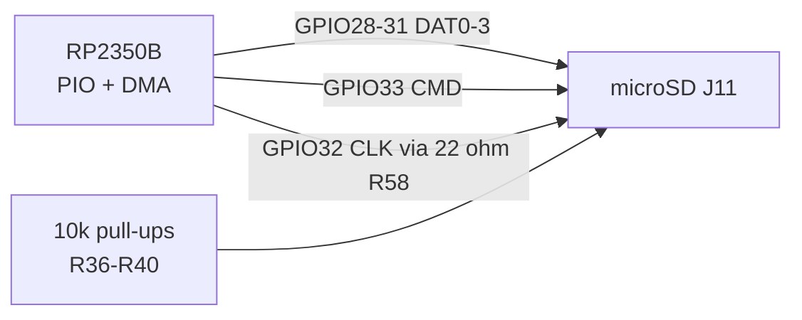

# microSD device facts (MARV V2 Rev 1)

Part of [pio-sdmmc](../README.md)

The board has one microSD socket (Molex 47219-2001, J11) on a native 4-bit SD bus driven by PIO + DMA, not SPI mode. All GPIO are 3.3 V
logic and not 5 V tolerant; the socket and its pull-ups are powered from V3V3_SYS.

## Pins

| GPIO | Net | Function | Notes |
|---|---|---|---|
| 28-31 | SD_DAT0-3 | PIO DAT0-3 | 10k pull-up (R36-R40) |
| 32 | SD_CLK_MCU | PIO clock | through 22 ohm R58 to SD_CLK; no pull-up |
| 33 | SD_CMD | PIO command | 10k pull-up (R36-R40) |

- DAT0-3 are consecutive in ascending GPIO order (a PIO `in pins` requirement). All six signals are in the GPIO16-47 PIO window, so
  every PIO user on the board shares GPIOBASE = 16.
- The socket has no card-detect switch and no GPIO is used for detect: the application learns whether a card is present from `init`
  (`Error::NoCard`).

## Tested card

| Item | Value |
|---|---|
| Card | SanDisk 64 GB SDXC, CID manufacturer 0x03, OEM "SD", product "SK64G", revision 8.0 |
| OCR | 0xC0FF8000 (high capacity, 3.2-3.4 V) |
| CSD | version 2, 124 735 488 blocks of 512 bytes |
| ACMD41 | ready after about 14 ms |
| Busy after a single-block write | about 1 ms |

## Code

`src/pio/` is the bus; the pins are arguments of `PioBus::new`, see [pio-bus](pio-bus.md).

## Related

- [pio-bus](pio-bus.md): GPIOBASE rule and clocking
- [driver](driver.md): what the card driver does with these cards

## Datasheet

| Device | URL |
|---|---|
| Molex 47219-2001 microSD socket | https://www.es.co.th/Schemetic/PDF/472192001.PDF |
