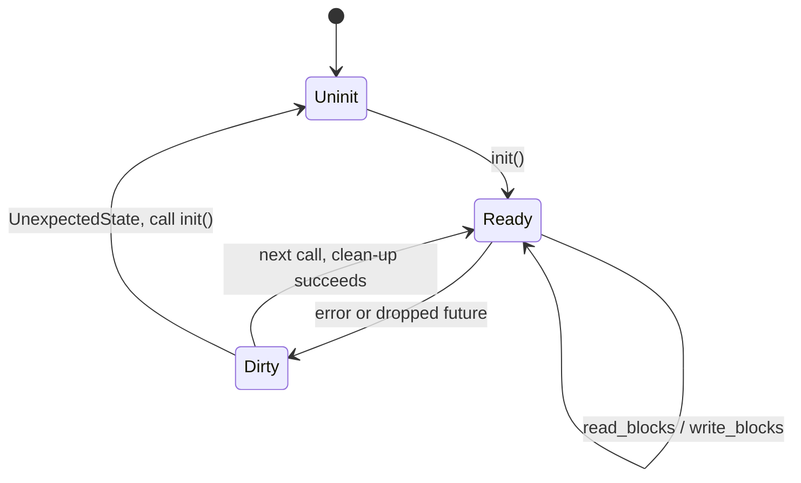

# Card driver

Part of [pio-sdmmc](../README.md)

`SdCard<B: Bus>` identifies the card, reads and writes 512-byte blocks and recovers from failed or cancelled operations. It has no
retry policy and no filesystem.

## What it does

| Item | Behaviour |
|---|---|
| `init` | Identifies the card, returns `CardInfo` (class SDSC/SDHC/SDXC, capacity in blocks, RCA, OCR, CID, CSD, SCR, granted data clock, CMD23 support) and switches to four-bit mode. May be called again at any time; it clears `info()` first, so after a failed `init` block calls return `NotInitialised` |
| `read_blocks`, `write_blocks` | Single and multi-block. CMD23 when the SCR allows it, otherwise open-ended with CMD12 (a write then sends ACMD23 with the count first). CRC16 checked on reads, CRC status token on writes, card status after each chunk |
| Range | A request past the card fails with `OutOfRange` before any bus traffic. More than 65535 blocks (one CMD23) is split |
| `status()` | CMD13 with error bits; runs the pending clean-up first |
| `stats()` | Commands sent, blocks read and written, read CRC errors, write rejections, timeouts, bad responses, recoveries |
| `Config` | Clock caps (identification at most 400 kHz, data at most 25 MHz); timeouts: ACMD41 polling 1000 ms, start of a read block 100 ms, each write wait 500 ms |

`Error`: `NotInitialised`, `NoCard`, `Unsupported { cmd, reason }`, `InitTimeout { waited_ms }`, `Bus { cmd, lba, error }`, `BadResponse`,
`CardStatus { status }`, `WrongState { state }`, `DataCrc { expected, got }`, `WriteRejected { token }`, `OutOfRange`,
`UnexpectedState`. Most carry the command index `cmd` and the block address `lba`.

## Recovery rules

- After a failed read or write the driver makes one clean-up attempt: CMD13; CMD12 only if the card still says it is in a data phase;
  wait for idle; CMD13. If the card is back in the transfer state the original error is returned and the next call works. Otherwise
  the call returns `UnexpectedState` and `init` is the remedy. A failed clean-up stays pending and is retried first by the next call.
- A dropped (cancelled) operation is recovered the same way by the next call.
- If an application command (CMD55 and the command after it) was cut short, the clean-up first sends CMD55 and ACMD23 for one block so
  the card does not take CMD13 for an application command: two extra commands on that call only.
- In a failed read, the blocks before the failed one hold valid data. `blocks_written` counts only blocks whose write was confirmed;
  after an interrupted write every other block is wholly old or wholly new.

## Logging

| Way | Notes |
|---|---|
| Records to consecutive blocks with `write_blocks` | Most predictable, no layer between application and card; a host tool must read the raw card |
| Feature `block-device-driver-0-2` | `SdCard` implements async `BlockDevice<512>` (`read`, `write`, `size`), reachable from `embedded-fatfs` through `block-device-adapters`. No filesystem is included or tested |

Through the trait every request uses a bounce buffer of 8 blocks (4 KiB): N blocks become `ceil(N / 8)` calls and one 512-byte copy per
block. A failed multi-chunk write leaves the earlier chunks on the card; a failed read leaves the buffer partly filled. The card
pauses now and then (write latency in [testing](testing.md)), so the writer has to buffer across the pause.

## Not covered

| Item | Note |
|---|---|
| High Speed (CMD6) | Default Speed only, 25 MHz at most |
| Erase, discard, ACMD13, ACMD22 | Command builders exist in `proto`; the driver does not use them |
| Retry policy | The error is returned after the one clean-up |
| Card detect | A missing card shows only as an error from `init` or an operation |
| Refused by `init` (`Unsupported`) | CMD8 range not 2.7-3.6 V, wrong CMD8 check pattern, SDUC, unreadable CSD, OCR capacity bit and CSD version disagree, SCR without four-bit width, RCA 0 on every request |
| Also not handled | SPI mode, 1.8 V and UHS-I, card lock, write-protect switch |
| Lints | The no-panic lint block is in place but does not cover `assert!`: the PIO back-end asserts two caller preconditions (data block of 4, 8, 64 or 512 bytes in `src/pio/driver.rs`; the response word count in `pio::wire::unpack_response`) |

## Code

| Path | Contents |
|---|---|
| `src/card/` | `init.rs`, `transfer.rs`, `recovery.rs`, `block.rs`, `error.rs` |
| `src/proto/` | Command builders, CRC, register and response decoding |
| `src/bus.rs` | The `Bus` trait |
| `src/blockdev.rs` | The block-device interface |

## Related

- [pio-bus](pio-bus.md): the transport
- [testing](testing.md): how these rules are tested
- [device](device.md): the card and socket
