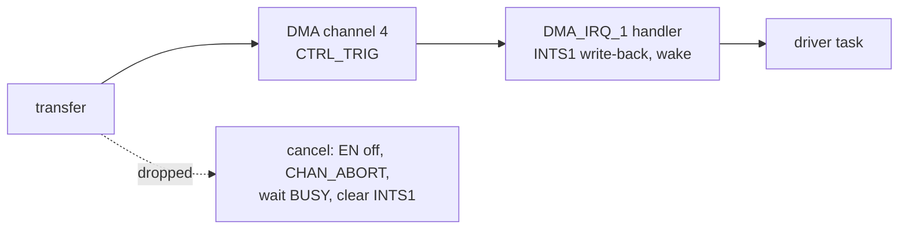

# PIO + DMA bus

Part of [pio-sdmmc](../README.md)

`PioBus` (feature `embassy-rp-0-10`) is the RP2350 transport: one PIO state machine and one DMA channel that completes on
`DMA_IRQ_1`. It depends on `embassy-rp` 0.10 with `unstable-pac`, `embassy-time` and `atomic-waker` 1.1. No back-end for
`rp2040-hal` or `rp235x-hal` exists; the core and the `Bus` trait are where one would go.

## What the application provides

| Item | Rule |
|---|---|
| Resources | One PIO state machine, one DMA channel, the `DMA_IRQ_1` binding to `DmaIrqHandler<W>` and a `static` waker behind `W: DmaWaker` (one bus per `DMA_IRQ_1`) |
| Pins | CLK, CMD, DAT0-3. DAT0-3 consecutive; all six below 32 or all 16 or above, a mix panics |
| Chip feature | `rp235xa` or `rp235xb` of embassy-rp (the on-board programs use `rp235xb`) |
| GPIOBASE | With CLK at GPIO32 or above (MARV V2: DAT0-3 = 28-31, CLK 32, CMD 33) the PIO block's GPIOBASE must be 16. Another state machine in the same block configured with all pins below 32 writes GPIOBASE back to 0 and breaks the bus: use another PIO block, or include a pin of 16 or above |
| Clock | `clk_sys` 150 MHz in the on-board programs. One SD clock is six state-machine cycles with an integer divider: 150 MHz gives 25 MHz data and 396.8 kHz identification. Default Speed only |
| Card | 3.3 V, native four-bit |

## Why its own DMA path

The bus programs its channel through the PAC and never builds an `embassy_rp::dma::Channel`. embassy-rp 0.10 puts every channel on
`DMA_IRQ_0`, and its `Transfer::drop` aborts with a read-modify-write of the `CHAN_ABORT` register shared by all channels. That is unsafe
when the other core runs embassy DMA transfers, as the flight core does on MARV V2.

| Stage | Behaviour |
|---|---|
| Construction (`PioBus::new`, on the core taking the interrupt) | The channel's bit is cleared in INTE0, INTE2 and INTE3 and set in INTE1 through the atomic CLR/SET aliases; `DMA_IRQ_1` gets priority 3 and is enabled in the calling core's NVIC. `DMA_IRQ_0` is untouched beyond clearing the channel's own bit |
| Handler `DmaIrqHandler<W>` | Reads INTS1, writes the value back (write 1 to clear) and wakes `W::waker()`. No lock, critical section or panic |
| Transfer | READ_ADDR, WRITE_ADDR, TRANS_COUNT (words), then CTRL_TRIG: word size, increment on the memory side only, the state machine's TX or RX DREQ, CHAIN_TO itself, interrupt on completion. The waker is registered before the trigger. Uses: staged stream to the TX FIFO, data block from the RX FIFO (armed before the header goes in), response words from the RX FIFO |
| Completion | Channel idle and its raw interrupt acknowledged by the handler, with no READ_ERROR or WRITE_ERROR and the address at start + 4 x count; otherwise `BusError::Fault`. TRANS_COUNT is not used (an abort holds it at 0, erratum RP2350-E5). A missing interrupt shows as `BusError::Timeout` |
| Cancel (dropped transfer) | RP2350-E5 sequence plus pico-sdk's BUSY poll: (1) clear CTRL.EN through the CLR alias of AL1_CTRL; (2) write the channel bit to CHAN_ABORT, a plain write; (3) spin until CHAN_ABORT bit and CTRL.BUSY are 0, at most 100 us, else the bus is dead and every later call returns `Fault` until a new `PioBus`; (4) write the bit to INTS1. Runs before the state machine reset and before the buffer is released. The channel was at rest by the second poll in a 2 000-cancel probe |

Registers shared by all channels (INTR, INTE0-3, INTF0-3, INTS0-3, CHAN_ABORT, MULTI_CHAN_TRIGGER) are written only through SET/CLR aliases
or as plain writes of the bus channel's own bit; `grep -rnE 'DMA\.(intr|inte|intf|ints|chan_abort|multi_chan_trigger)\([^)]*\)\.modify' src`
prints nothing.

## Limits

- Run the bus in thread mode or in an interrupt executor below priority 3. From an executor at priority 3 or above the handler cannot
  run while that interrupt is active: completions are seen late and a transfer finishing just before its deadline can report `Timeout`.
- A late write-back by another core's embassy `Transfer::drop` can still cut a transfer short; the end-address check turns that into `Fault`.

## Code

`src/pio/`: `driver.rs` (PioBus), `dma.rs` (channel, handler, cancel), `wire.rs` (frames), `hooks.rs` (test hooks).

## Related

- [driver](driver.md): the card driver above the `Bus` trait
- [device](device.md): pins and electrical facts
