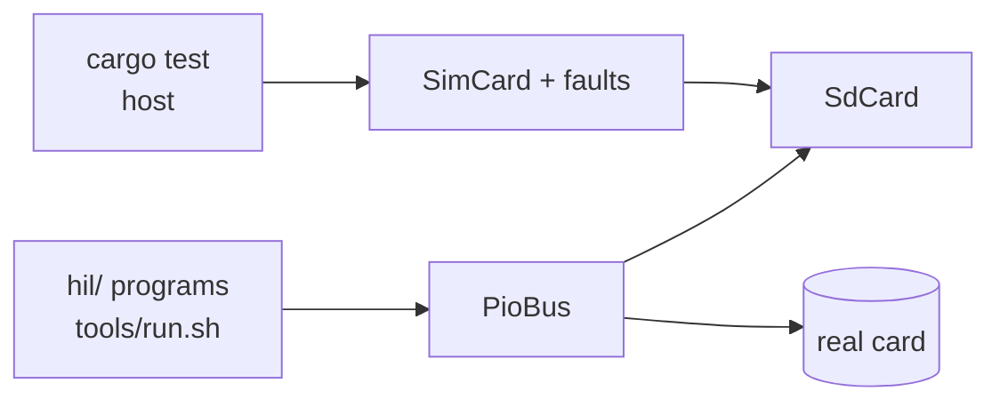

# Testing

Part of [pio-sdmmc](../README.md)

Everything except the PIO bus itself runs on the host against `SimCard`, which models the card in virtual time. The PIO bus and the
real card are exercised by the on-board programs in `hil/`.

## Host

`cargo test --no-fail-fast` (plain `cargo test` stops at the first failing binary). No flag for `sim`: the dev-dependencies turn it on.
With `--features block-device-driver-0-2` the trait tests run too. The README example is compiled by `cargo test --doc --features sim`.

| Tests | Cover |
|---|---|
| `tests/card_faults.rs`, `card_failures.rs` | Each simulated fault kind and each `Unsupported` reason, through the driver; asserts the exact error and that the next call works |
| `tests/card_sweeps.rs` | A bus failure at every phase and a dropped future at every await, single and multi-block, with and without CMD23 |
| `tests/blockdev.rs` | The block-device trait |
| `tests/sim_*.rs` | The simulated card itself |

`SimCard` (feature `sim`, host only) is a `Bus` that records a trace and lists protocol violations. `inject(Fault, Trigger)` adds: no
response, flipped response, data or CRC bit, CRC-error and write-error tokens, long busy, status error bits, card removal, ACMD41 never
ready. The three failing-recovery cases (CMD55/ACMD23 cut) are also covered here.

## On the board

`tools/run.sh <program>` builds, flashes through a debug probe and runs one program from `hil/` under a lock (runs never overlap). Exit
status 0 means every check passed; logs go to `hil/logs/` (git-ignored).

| Program | What it proves |
|---|---|
| `alive` | Tool chain, probe and board |
| `sd_bus` | The PIO bus alone: identification at 400 kHz, reads, writes, a deliberately late DMA transfer, speed at 25 MHz. Hil feature `negative-no-inte1` (negative control) removes the channel from INTE1 after `PioBus::new`: every DMA transfer must time out, so identification fails |
| `sd_smoke` | The card driver on the real bus: identification, 1 MiB write and read-back compare, throughput by call size, 4 KiB write latency, `OutOfRange` then a normal read |
| `sd_blockdev` | The trait on the real bus: round trips against the direct path, a request across the 8-block chunk boundary, trait against direct throughput |
| `sd_faults` | Recovery on the real card: reads and writes cancelled by time and at every suspension point, the application-command pair cut between CMD55 and ACMD23, positive controls that find the card not ready when the clean-up is left out, identity and data intact at the end |

`sd_smoke`, `sd_blockdev` and `sd_faults` overwrite a fixed scratch area (1 MiB from block 50000000). `sd_bus` overwrites blocks at random
addresses between block 1000000 and 1000000 blocks before the end of the card, and from block 8000000. Use an expendable card.

## Reference figures

MARV V2 Rev 1, `clk_sys` 150 MHz, 25 MHz data clock, `DMA_IRQ_1` back-end on channel 4, one SanDisk 64 GB card. Single runs, not statistics;
the cost per block depends on the binary's layout.

| Blocks per call | Write | Read |
|---|---|---|
| 1 | 0.41 MB/s (longest call 31.9 ms) | 1.37 MB/s |
| 8 | 3.12 MB/s | 4.69 MB/s |
| 64 | 7.61 MB/s (longest call 4.4 ms) | 7.14 MB/s |
| 256 | 8.97 MB/s (longest call 15.1 ms) | 7.56 MB/s |

| Measurement | Value |
|---|---|
| 256 consecutive 4 KiB (8-block) writes | mean 1302 us, worst 1387 us |
| 256 blocks per call, direct | write 5.86 MB/s, read 9.67 MB/s |
| 256 blocks per call, through the trait | write 2.21 MB/s, read 5.05 MB/s |
| Raw bus, 2048 blocks | write 9.93 MB/s, read 10.76 MB/s; wire time per read block at 25 MHz 41.7 us (1042 clocks, computed), 12.29 MB/s |
| Single-block read | mean 264 us, worst 560 us |
| Single-block write including busy | mean 1365 us, worst 1518 us |
| Cancelled operations on the real card (per run) | about 400 reads and 390 writes, plus the CMD55/ACMD23 pair cut 52 times: 0 failed next operations, 0 wrong bytes, 0 bytes damaged outside the written range |
| Negative control | CMD0 `Err(Timeout)`, CMD8 `Err(Bus(Timeout))`, `RESULT: FAIL (2 failed checks)`, no write sent |

Cancels on the real card landed in the data phase or between operations; none landed inside a command frame or a busy wait. Those cases,
read CRC errors, rejected writes, timeouts, card removal and power loss are proven on the simulated card only. The tested card supports
CMD23; the ACMD23 route was taken only because the test hides the CMD23 bit from the driver.

## Cargo features

All are off by default.

| Feature | Enables |
|---|---|
| `std` | `std` in the crate; turned on by `sim` |
| `sim` | The simulated card with fault injection (host only) |
| `defmt` | `defmt::Format` on the public types |
| `embassy-rp-0-10` | `pio::PioBus`, `DmaIrqHandler`, `DmaWaker` |
| `block-device-driver-0-2` | `BlockDevice<512>` for `SdCard` (block-device-driver 0.2, aligned) |
| `_test-hooks` | Entry points only the on-board back-pressure test uses; outside any promise |

## Related

- [driver](driver.md): the recovery rules under test
- [pio-bus](pio-bus.md): the transport the board programs exercise
